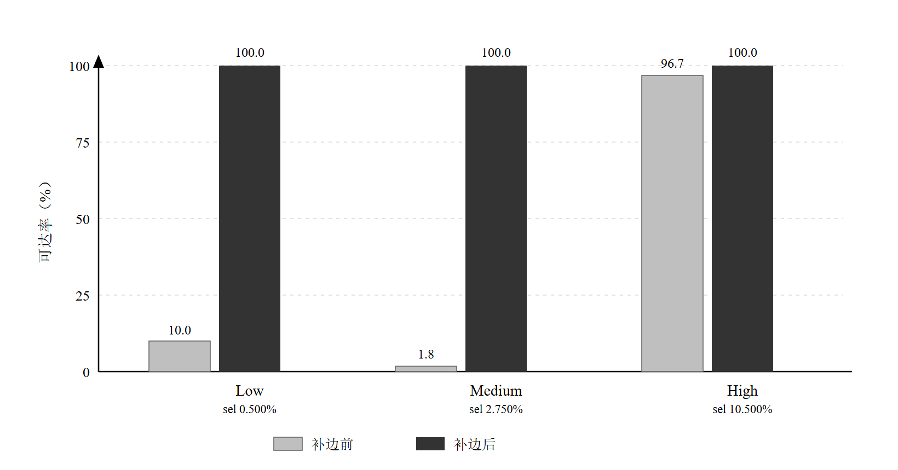

# fvs-opt-prototype

针对课程实验报告 §5 所提优化方向 **「构建期同标签补边（label-aware edge stitching）」** 的最小实现与机制验证。

## 1. 问题

SSD 上的过滤向量检索（Filtered ANNS）在图索引上存在一个结构性矛盾：

- **图按几何邻近建**：Vamana / HNSW 的边连接的是向量空间中相近的点；
- **谓词按属性划分**：一条查询只关心带某个标签的子集 `X_P`。

两者切分不一致时，`X_P` 在图上被切成若干互不连通的碎片。搜索只能到达与入口同处一个碎片的那部分合格节点，其余天然不可达——这就是课程实验中观察到的现象：某系统在强过滤档（selectivity 0.545%）把搜索预算加到 8 倍，Recall 仍比弱过滤档低约 9.5 个百分点，且剩余缺口对预算完全不敏感。

**补边的思路**：建图后，对每个标签把它的碎片用少量边缝起来，使 `X_P` 的子图连通。代价是每个标签 O(1) 条边与一次离线构建。

## 2. 目录

```
fvs-opt-prototype/
├── README.md
├── run_experiment.py            # 主实验入口：可达率
├── experiments/
│   ├── sensitivity.py           # 入口 / 种子稳健性检查（§7）
│   ├── beam_search.py           # 预算受限搜索 Recall@10（§8）
│   ├── ablation_long_edges.py   # 长边消融（§3）
│   └── stitch_cost.py           # 补边的结构代价：边数/度数/边长/连通性（§5、§6）
├── src/
│   ├── dataset.py               # 合成数据：几何聚类 + Zipf 标签（二者独立生成）
│   ├── graph.py                 # kNN 图构建
│   ├── connectivity.py          # 标签诱导子图的连通分量与可达率
│   ├── patch.py                 # 同标签补边
│   └── metrics.py               # 指标汇总与 CSV 输出
└── results/
    ├── connectivity.csv         # 三档 selectivity × 补边前后的指标
    ├── edges_added.txt          # 每个标签补了几条边
    ├── reach_before_after.png   # 可达率对比图（§6 引用）
    ├── reach.svg.html           # 同一对比图的可交互版本（浏览器打开）
    ├── sensitivity.csv          # 36 组（数据集种子 × 图种子）的可达率
    ├── sensitivity_summary.txt  # 上述汇总（§7 引用）
    ├── beam_recall.csv          # 预算扫描逐次读数（3 组种子）
    ├── beam_recall_summary.csv  # 上述汇总：中位数与 min–max（§8 引用）
    ├── ablation_long_edges.csv  # 长边消融（§3 引用）
    └── stitch_cost.csv/.txt     # 补边代价（§5、§6 引用）
```

## 3. 运行

```bash
python run_experiment.py
```

无第三方依赖（只用 Python 标准库）。默认参数：2000 个点、24 个高斯簇、kNN 的 k=24、每点另加 4 条随机长边（双向化后平均度约 36.75）、40 个标签、Zipf 指数 1.2，单核约 3 秒跑完，结果确定性可复现。

长边这一层不能省。实测去掉长边（n_long=0）后，整张图仍是**单一连通分量**——kNN 双向化后簇边界上的点会把簇连起来——但**标签诱导子图**的碎片化明显加剧：High 档从 6 个分量增至 32 个，可达率 96.7% → 32.9%。Vamana 的 α 剪枝本就保留「远距离但方向不同」的跨簇边，本原型用每点 4 条随机长边近似这一层。

另两个脚本：

```bash
python experiments/sensitivity.py   # 入口 / 种子稳健性，出 results/sensitivity.csv
python experiments/beam_search.py   # 预算受限 Recall@10，出 results/beam_recall.csv
python experiments/ablation_long_edges.py  # 长边消融，出 results/ablation_long_edges.csv
python experiments/stitch_cost.py          # 补边代价（度数/边长/连通性），出 results/stitch_cost.csv
```

## 4. 指标

对每个标签 `L`，在「两端都带 L」的边构成的诱导子图上计算：

| 指标 | 含义 |
|---|---|
| `n_nodes` | 带 L 的节点数（决定 selectivity） |
| `components` | 诱导子图的连通分量数 |
| `largest_frac` | 最大连通分量占该标签节点比例 |
| `reach_rate` | **从入口点出发、BFS 能到达的 L 节点占比**（模拟搜索可达性） |
| `edges_added` | 补边新增的边数 |

`reach_rate` 是核心指标：它直接对应「图搜索能不能找到这些合格节点」。BFS 只沿「两端都带 L」的边扩展，与运行时前置过滤的语义一致。

## 5. 补边算法

```
for 每个标签 L:
    comps ← L 诱导子图的连通分量
    main  ← 最大的分量
    while 存在非 main 的分量 and 新增边数 < 预算:
        在所有 (a ∈ 非main分量, b ∈ main) 中找距离最小的一对
        加边 a—b，把 a 所在分量并入 main
```

每次合并选「跨分量最近的一对点」，所以补的边是**跨碎片可选的最短连接**。但要说清程度：实测补边长度中位数 11.3、
最长 57.8（坐标场宽 100），而常规 kNN 边中位数只有 4.4——补边比常规边长约 2.6 倍，
它做的是「把碎片缝起来」，不是「保持局部性」。复杂度 O(|L|²) 最坏，本实验规模下可接受。

以上数字由 `experiments/stitch_cost.py` 产出（含边数、度数、边长分位数与补边后连通性自检）。

## 6. 实测结果

| 档位 | selectivity | 补边前可达率 | 补边后 | 连通分量 |
|---|---:|---:|---:|---|
| Low | 0.500% | 10.0% | 100.0% | 10 → 1 |
| Medium | 2.750% | 1.8% | 100.0% | 27 → 1 |
| High | 10.500% | 96.7% | 100.0% | 6 → 1 |



三点值得注意：

1. **弱过滤档补边前已接近连通**（96.7%，该入口下）。定性上与课程实验中 GateANN 在 High bucket 的 93.2% 召回同向，
   但两者指标不同（可达率 vs 召回），且 96.7% 只是单次入口抽样的结果（见 §7），
   只能作定性佐证，不宜当成定量对应关系。
2. **强过滤档从 10.0% 恢复到 100%**，增益 +90 pp。缺口来自结构不连通，不是搜索预算不足——
   §8 的预算扫描是直接证据：补边前 Low/Medium 的 Recall 在 10→160 的预算范围内完全不动。
3. **Medium 的 1.8% 低于 Low 的 10.0%** 是入口运气，不是档位性质：该标签的节点零散分布在多个簇，
   全局入口恰好落进一个单点分量，从入口出发只能到达这一小簇。把入口遍历一遍取平均，
   Medium 是 8.0%、Low 是 12.0%，同一量级（见 §7）。这也提示 medoid 的选择在强过滤下同样影响召回。

代价：40 个标签共补 618 条边，占原图 36,748 条的 1.7%；补边离线完成，不进查询热路径。
补边后 40 个标签的诱导子图全部连通（无标签触到补边预算上限），补边均在同标签内部（跨标签边 0 条），
度数无异常膨胀（平均 36.75 → 37.37，最大度数 57 不变，单点最多新增 6 条）。

## 7. 稳健性：可达率依赖入口落在哪个碎片

`reach_rate` 的定义是「从入口出发能到达的合格节点占比」，而它恒等于**入口所在连通分量的大小占比**。
所以单次测量只是一个抽样：入口落在哪个碎片，读数就是多少。12 组种子设置（3 个数据集种子 × 4 个图种子）、
每组三个档位共 36 行，实测：

| 档位 | 中心入口 reach 的 min–max | 中位数 | 遍历入口的平均 |
|---|---|---:|---:|
| Low | 9.1% – 10.0% | 10.0% | 12.0% |
| Medium | 1.5% – 7.3% | 1.6% | 8.0% |
| High | 0.9% – 99.6% | 98.2% | 95.9% |

- **Low 稳健**：节点两两不连通，reach 恒等于 1/n，与入口无关。
- **High 的左尾很长**：入口一旦落进小碎片，读数就从 ~98% 掉到 1% 量级。本仓库主实验的 96.7% 是一个正常抽样，
  但不能当作档位属性——「弱过滤基本连通」在入口平均意义下（95.9%）成立，在单次抽样意义下不成立。
- **Medium 的 1.8% 是低端抽样**：入口平均 8.0%，与 Low 的 12.0% 同量级。

## 8. 补边的实际收益：固定预算下的 Recall@10

补边后 reach 必然是 100%——可达性由构造保证，它证明不了搜索质量。真正的检验是固定预算下的 Recall。
做法：Vamana 式 best-first 扩展，只走合格节点（前置过滤语义），预算 = 展开节点次数 b；
**3 组独立种子**（点 / 标签 / 查询各自重新生成），每档每预算取中位数，括号内为跨种子的 min–max。

| 档位 | 节点数 | 阶段 | b=10 | b=20 | b=40 | b=80 | b=160 |
|---|---:|---|---:|---:|---:|---:|---:|
| Low | 10 | 前 | 10.0 (8–10) | 10.0 | 10.0 | 10.0 | 10.0 |
| Low | 10 | 后 | 100 | 100 | 100 | 100 | 100 |
| Medium | 55 | 前 | 1.2 (1–17) | 1.2 | 1.2 | 1.2 | 1.2 |
| Medium | 55 | 后 | 33.2 (12–34) | 43.0 (33–72) | 96.0 (92–97) | 100 | 100 |
| High | 210 | 前 | 32.2 (16–56) | 52.5 (47–72) | 76.5 (71–84) | 85.0 (84–93) | 96.5 (94–98) |
| High | 210 | 后 | 32.2 (16–56) | 52.8 (47–71) | 77.8 (76–84) | 86.8 (86–93) | 99.5 (99–100) |

四点观察：

1. **Low/Medium 补边前对预算完全不敏感**：b 从 10 到 160（十六倍），中位数一动不动。
   这正是课程实验「预算加到 8 倍仍差 9.5 pp」的最小复现——缺口不是预算不够，是走不到。
   **注意量纲**：这里 b 是「展开节点次数」，与课程实验的搜索预算 L 不是同一尺度，只能作定性对照。
2. **补边把缺口消掉**：Low 在最小预算 b=10 就到 100%，Medium 从 1.2% 抬到 33.2%（b=10）、b=80 饱和。
3. **弱过滤（High）补边前后几乎无差别**：b=160 时 96.5% → 99.5%，中间各档差异都在 1–2 pp 内。
   High 本身已基本连通，补边不是它的主要矛盾——这与「缺口来自强过滤」的判断一致。
4. **代价是路径变长**：Medium 补边后要八倍预算（10 → 80）才饱和。补边用的是「碎片挂到主分量最近点」的
   星形结构，够到远处碎片要多跳几次。**补边保证连通，不保证短路径**，这是本方案最该继续改的地方。

**两个必须说明的限定**：

- **Low 档只有 10 个节点**（2000 × 0.5%）。补边后 100% 是因为星形中心一跳就覆盖全部 10 个节点，
  说服力有限；真正有分量的是 Medium（55 个节点，仍需八倍预算才饱和）。
- **跨种子波动不小**：High 在 b=10 的范围是 16–56，Medium 补边前的范围是 1–17。
  单次运行的读数不能当结论用——这与 §7「reach 是抽样」是同一个原因。

**入口策略对照**（b=10，中位数）：把入口从「离图中心最近的合格点」换成随机合格点，
Low 10.0 → 11.6、Medium 1.2 → 6.5、High 32.2 → 28.3。方向不变，但绝对值受入口影响明显，
因此报告任何可达率或召回数字时都应交代入口怎么选。

## 9. 边界

本原型在**合成 2D 点集 + kNN 图**上验证机制，**不是** GateANN 的真实索引重建：

- 合成数据的几何聚类比真实嵌入更规整，碎片化程度可能偏乐观；
- kNN 图比 Vamana 少了剪枝，度数分布不同；
- 未计入补边后的索引体积与构建时间增量。

要得到系统层结论，需在 GateANN 的构建流程中加入补边并重跑 Low bucket——这一步依赖完整的 WSL + 源码 + 预构建索引环境，本仓库不包含。
